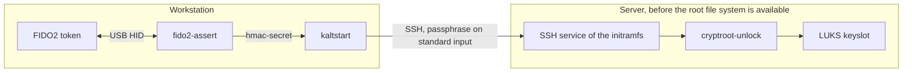

# kaltstart

Remote unlock of LUKS-encrypted Linux servers with a FIDO2 security token.

kaltstart is a command-line tool for the administrator's workstation. It
obtains a secret from a FIDO2 token through the `hmac-secret` extension and
submits it as a LUKS passphrase to the initramfs of a remote server over
SSH, where the distribution's standard `cryptroot-unlock` consumes it. The
token never leaves the workstation, and no additional software is installed
on the server.

*Kaltstart* is German for "cold start".

> [!WARNING]
> kaltstart is a proof of concept. It has not been released and has not been
> verified with a physical token; see
> [docs/verification.md](docs/verification.md). A typed passphrase and
> out-of-band console access to the server must remain available during any
> trial.

## How it works



1. kaltstart waits until the SSH port of the initramfs accepts
   connections.
2. The token derives a 32-byte value from its credential and the salt of
   the host. This step requires a touch and, unless the credential was
   created with `--no-pin`, the token PIN.
3. The Base64 text of that value is the passphrase of an additional LUKS
   keyslot. kaltstart writes it to the standard input of `cryptroot-unlock`
   over SSH. The host key of the server must already be known.
4. If `booted_port` is configured, kaltstart waits until the SSH port of
   the running system accepts connections.

The software that communicates with the token stays on the workstation.
The server receives only the result of one derivation, which it needs in
any case, and cannot send requests to the token. The passphrase format is
the convention of `systemd-cryptenroll`.

## Requirements

Workstation (Linux):

- Python 3.9 or later
- fido2-tools (`fido2-assert`, `fido2-cred`, `fido2-token`)
- OpenSSH client (`ssh`, `ssh-keygen`)
- a FIDO2 token that supports the `hmac-secret` extension and has a PIN
  set; the PIN protects the passphrase only on tokens that implement
  CTAP 2.1 or the `credProtect` extension (see
  [docs/security.md](docs/security.md#the-token-pin))

Server (Debian 13):

- `dropbear-initramfs` and `cryptsetup-initramfs`
- `keyutils`, if the `decrypt_keyctl` keyscript is used

## Installation

kaltstart is a single executable file:

```sh
install -D -m 0755 kaltstart ~/.local/bin/kaltstart
```

## Quick start

The server is prepared once as described in
[docs/server-setup.md](docs/server-setup.md), sections 1 to 8. The examples
use the server `srv01.example.net`, whose initramfs accepts SSH connections
on port 2222.

1. Create a credential on the token. The token asks for a touch and, if it
   requires one, for its PIN.

   ```sh
   kaltstart init
   ```

2. Register the server and validate the local configuration.

   ```sh
   kaltstart add-host srv01 --host srv01.example.net --port 2222 --booted-port 22 \
       --identity ~/.ssh/id_ed25519_unlock \
       --known-hosts ~/.ssh/known_hosts.initramfs \
       --device-on-server /dev/disk/by-uuid/00112233-4455-6677-8899-aabbccddeeff
   kaltstart check srv01
   ```

3. Enroll the derived passphrase in a new keyslot of the running system.
   cryptsetup asks for an existing passphrase, which remains valid as the
   fallback. `enroll` reports the number of the new keyslot, which should
   be recorded.

   ```sh
   kaltstart enroll srv01
   ```

4. Unlock the server after a reboot.

   ```sh
   kaltstart unlock srv01
   ```

## Limitations

- Every start requires a person with the token. Unattended unlocking is
  not supported.
- Only servers that use Debian's initramfs-tools with `cryptroot-unlock`
  are supported. Workstations other than Linux have not been tested.
- A server whose boot files were modified, or whose initramfs host key was
  copied, is not detected; see [docs/security.md](docs/security.md).
- Rotating a passphrase and removing the keyslots of a lost token are
  manual procedures.

## Roadmap

1. Verification with physical tokens, as listed in
   [docs/verification.md](docs/verification.md).
2. A check at `init` that the token applied the `hmac-secret` extension and
   the PIN requirement to the new credential.
3. `rotate` and `revoke` commands that replace the manual procedures.

## Documentation

- [docs/server-setup.md](docs/server-setup.md): preparing a server
- [docs/commands.md](docs/commands.md): commands, options and exit statuses
- [docs/configuration.md](docs/configuration.md): configuration file
- [docs/security.md](docs/security.md): threat model, secret handling,
  fallback access and procedures
- [docs/verification.md](docs/verification.md): what has been verified
- [SECURITY.md](SECURITY.md): reporting security issues
- [CONTRIBUTING.md](CONTRIBUTING.md): reports and changes

## Tests

```sh
python3 -I -m unittest discover -s tests -v
```

The test suite uses stub executables and a model of the server side. It
requires neither a token nor a server, and it does not verify behavior on
real hardware. The CI workflow runs it with Python 3.9 to 3.14.

## License

kaltstart is free software, licensed under the GNU General Public License,
version 2 only (GPL-2.0-only). See [LICENSE](LICENSE).
